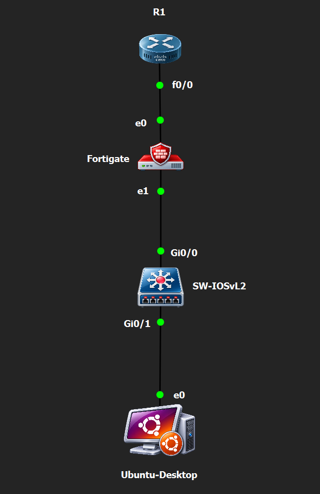
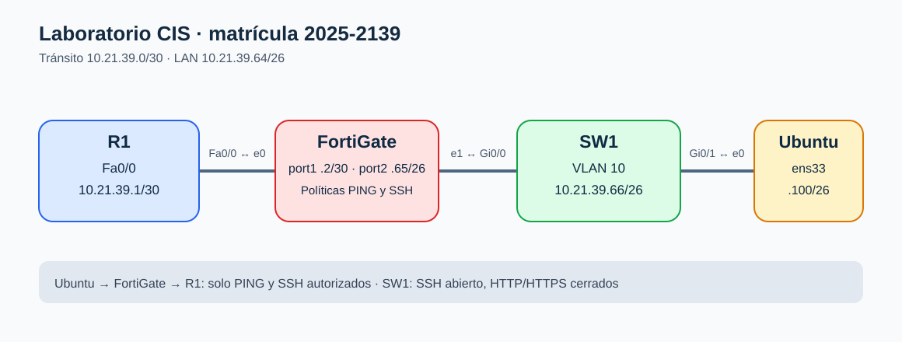

**Video demostrativo individual:** [ver en YouTube](https://youtu.be/JYM2anQrunU).

# Laboratorio individual de hardening basado en CIS

**Estudiante:** Adrian Magallanes · **Matrícula:** 2025-2139  
**Entorno:** GNS3 · Cisco IOS 15.2 · FortiOS 7.0.9 · Ubuntu Desktop

## Propósito

Evaluar controles de seguridad seleccionados en un router, un switch y un firewall; aplicar medidas de hardening mediante un script; comparar informes previos y posteriores; y comprobar que los servicios necesarios de la red siguen disponibles.

La red usa `10.21.39` por los dígitos `21-39` de la matrícula. R1 y FortiGate comparten `10.21.39.0/30`; FortiGate, SW1 y Ubuntu comparten `10.21.39.64/26`. El [diseño detallado](docs/TOPOLOGIA.md) muestra interfaces, rutas y políticas.

## Resultados observados

| Prueba | Antes | Después |
|---|---|---|
| Script de auditoría | Informe sin cambios: SW1 6, R1 4 y FortiGate 1 hallazgos | Informe posterior: todos los controles seleccionados `CUMPLE` |
| Política FortiGate 1 (PING Ubuntu → R1) | Desactivada: 0/5 respuestas | Activada: 5/5 respuestas |
| Conectividad posterior | — | Ubuntu obtuvo 3/3 respuestas de SW1, FortiGate y R1 |
| Administración del switch | — | Puerto 22 abierto; 80 y 443 cerrados |

Las capturas publicadas se encuentran en [evidencias](evidencias/). La [matriz de pruebas](docs/PRUEBAS.md) distingue las capturas publicadas de resultados facilitados por el estudiante que todavía no tienen captura en el repositorio. El análisis se limita a los controles elegidos: **no representa una certificación CIS**. El router virtual requiere algoritmos SSH heredados para compatibilidad; esta limitación está documentada.

## Contenido

- [Topología y direccionamiento](docs/TOPOLOGIA.md)
- [Controles CIS, motivos y límites](docs/CIS.md)
- [Pruebas y evidencias](docs/PRUEBAS.md)
- [Script de auditoría](scripts/hardening.py) y [modo de uso](scripts/README.md)
- [Informes anteriores y posteriores](reportes/)
- [Running-configs sanitizados](configs/)

## Estado de entrega

Las pruebas de red y la ejecución del auditor están realizadas. Los informes de `reportes/` contienen los resultados obtenidos con el script en Ubuntu antes y después de aplicar las reglas. `scripts/hardening.py` es el bloque de 322 líneas utilizado en esa ejecución. Las configuraciones de Cisco excluyen líneas `secret`; la de FortiGate documenta las interfaces, objetos, políticas y ruta usados en el laboratorio. Las contraseñas temporales divulgadas durante la configuración deben cambiarse. El TXT incluye los enlaces de GitHub y YouTube con el formato de nombre exigido.
