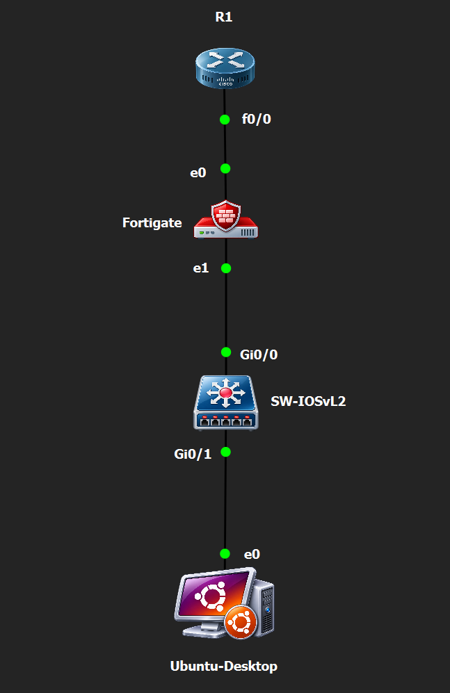
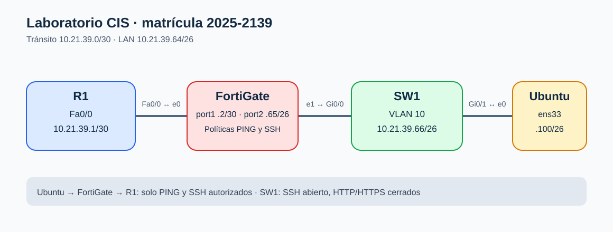

# Topología y direccionamiento

| Enlace | Puerto | Dirección |
|---|---|---|
| R1 ↔ FortiGate | R1 Fa0/0 ↔ FortiGate e0/port1 | R1 `10.21.39.1/30`; FortiGate `10.21.39.2/30` |
| FortiGate ↔ SW1 | FortiGate e1/port2 ↔ SW1 Gi0/0 | FortiGate `10.21.39.65/26` |
| SW1 ↔ Ubuntu | SW1 Gi0/1 ↔ Ubuntu e0/ens33 | SW1 VLAN 10 `10.21.39.66/26`; Ubuntu `10.21.39.100/26` |

R1 tiene una ruta estática a `10.21.39.64/26` por `10.21.39.2`. Ubuntu usa `10.21.39.65` como puerta de enlace. Los puertos Gi0/0 y Gi0/1 de SW1 pertenecen a VLAN 10. Las políticas FortiGate permiten desde `10.21.39.100` hacia `10.21.39.1` solo PING y SSH, en reglas separadas. El resto del tráfico entre estos segmentos no tiene una regla de aceptación documentada.

Las direcciones se derivan de la matrícula **2025-2139**. El segmento `/30` es de tránsito; el `/26` contiene la LAN. La IP de Ubuntu fue configurada temporalmente en `ens33` durante el laboratorio, por lo que debe hacerse persistente o repetirse tras reiniciar la VM.
